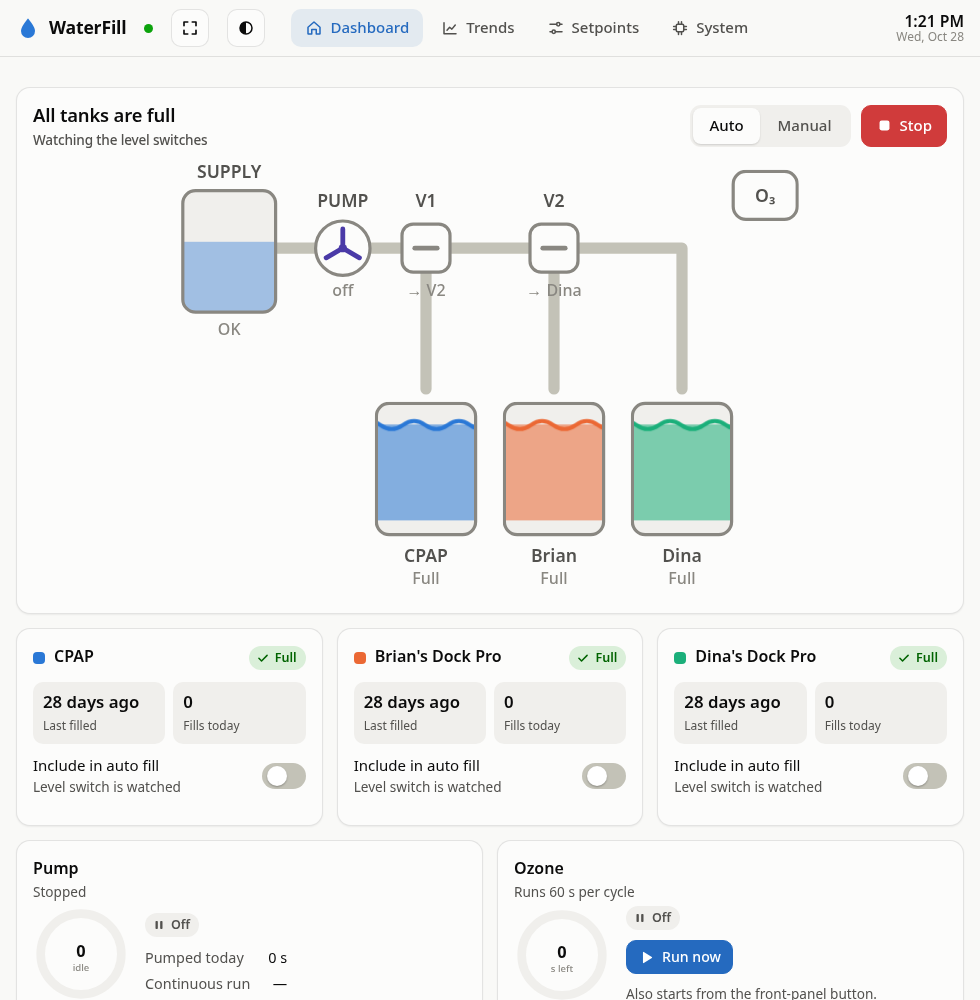

# WaterFill

An ESP32 controller that keeps three bedside water reservoirs topped up automatically: a CPAP
humidifier and two bed-cooling units (Dock Pro). It runs one pump and two solenoid valves from a
shared supply tank and adds a timed ozone treatment, with a live web dashboard and Home Assistant
integration.



## How it works

```
SUPPLY ─▶ PUMP ─▶ V1 ─┬─▶ CPAP          (V1 on)
                      └─ V2 ─┬─▶ Bed 1  (V1 off, V2 on)
                             └─▶ Bed 2  (both off)
```

A level switch in each tank calls for water. The controller routes the flow with the valves,
runs the pump until that tank's switch reads full, then moves on to the next tank that needs
water.

## Safety first

The control logic is written to fail safe, and every rule below is covered by tests:

- All relays are forced **off at boot**, while an OTA update runs, and whenever the I/O
  expander fails
- Valves move **before** the pump starts, and the pump stops **before** valves move
- Pump maximum run time plus enforced rest, which still applies when the target tank changes
- An empty supply tank blocks the pump (fast trip, slow recovery)
- A per-fill pump-time limit **latches a fault** until it is cleared in the UI
- Stop turns everything off and switches to Manual; manual runs time out on their own
- Hardware task watchdog; control never depends on Wi-Fi

`control.cpp` contains only logic, with no Arduino code, so it is **unit-tested on a PC**.
The tests combine scenarios with a randomized fuzz run that checks the safety invariants on
every 50 ms tick: 4.1 million checks, 0 failures.

```sh
sh tests/run.sh      # g++ with AddressSanitizer + UBSan
```

## Features

- Single-file **web UI** (no CDN) with a live plumbing diagram, per-tank status, Auto/Manual
  modes, trends and a full setpoints editor; light and dark themes
- Every input's polarity is a setting, so a wiring change is a toggle in the UI rather than a
  code change
- **History**: a 300-entry event log and 120 days of daily totals, CRC-checked on LittleFS
- Optional **PIN** to guard commands, configuration and OTA (status stays readable)
- **Wi-Fi with fallback AP**: if the network is gone for 45 s, the board starts its own access
  point and keeps retrying the home network in the background
- **MQTT / Home Assistant** integration
- **OTA updates** over HTTP and ArduinoOTA

## Hardware

| Part | Role |
|---|---|
| KinCony **KC868-A6** (ESP32) | Controller with 6 relays, 6 isolated inputs, I²C I/O expander |
| Pump, 2 × solenoid valves | Water routing |
| Float/level switches | Supply-low, plus one "full" switch per tank |
| Ozone generator + button | Timed water treatment |

## Repository layout

| Path | What it is |
|---|---|
| `WaterFill_v2/` | Current firmware (Arduino sketch) |
| `web/index.html` | Web UI source; `tools/build_ui.py` gzips it into `web_assets.h` |
| `tests/` | Host-side unit and fuzz tests for the control logic |
| `tools/mock_server.py` | Serves the UI with simulated data for UI work without hardware |
| `source/WaterFill_A6_R6/` | The original sketch, kept as a baseline (its Wi-Fi file is not included) |

## Building

1. Copy `WaterFill_v2/secrets.h.example` to `secrets.h` and set your Wi-Fi details. You can
   change them later in the UI.
2. Open `WaterFill_v2/WaterFill_v2.ino` in the Arduino IDE with the ESP32 core installed,
   then build and flash.
3. Browse to `http://waterfill.local/`.

To work on the UI without hardware: `python3 tools/mock_server.py`.

## Status

The V2 firmware and web UI are running on the board. Plumbing and sensor wiring are next.
